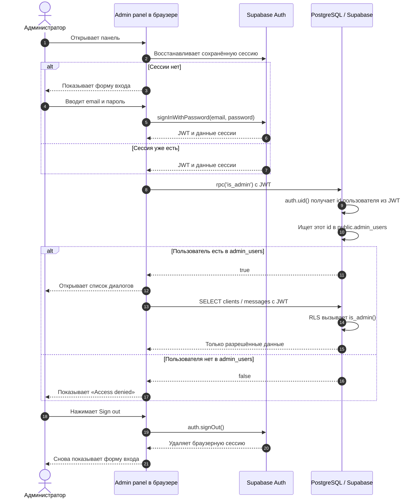

# Авторизация администратора через Supabase

Этот документ описывает текущую схему входа в `admin-panel`.

Важно: она становится доступна в удалённом Supabase только после применения миграции `20261123163258_secure_admin_realtime.sql`. До этого диаграмма описывает подготовленное поведение кода и базы данных.



## Идея в одной фразе

Войти по email и паролю недостаточно: Supabase сначала подтверждает личность, а наша таблица `admin_users` отдельно решает, является ли этот пользователь администратором.

Это похоже на проходную в офис:

1. Supabase Auth проверяет паспорт — email и пароль.
2. `admin_users` проверяет пропуск именно в админскую зону.

Поэтому обычный зарегистрированный пользователь не получает доступ к панели.

## Как называется этот подход

У схемы есть три простых названия. Не обязательно запоминать их сразу, но полезно узнавать, когда они встретятся в документации.

| Название | Простое значение | Как это выглядит у нас |
| --- | --- | --- |
| **Authentication (аутентификация)** | «Кто ты?» | Supabase проверяет email и пароль. |
| **Authorization (авторизация)** | «Что тебе разрешено?» | `is_admin()` проверяет, есть ли пользователь в `admin_users`. |
| **Allow-list** | «Явно разрешённый список» | Войти в панель могут только пользователи, чьи UUID добавлены в `admin_users`. |

Ещё это называют **RBAC-подобным подходом**: RBAC означает «доступ по ролям». В полноценном RBAC есть таблицы `users`, `roles`, `permissions` и много ролей. У нас пока самый простой и правильный вариант для одной роли: либо человек администратор, либо нет. Если позднее понадобятся, например, редактор и наблюдатель, `admin_users` можно заменить или расширить таблицей ролей.

## Почему проверок две, а не одна

Можно было бы проверить только пароль. Но тогда любой пользователь, которого случайно или намеренно зарегистрировали в Supabase Auth, сразу получил бы доступ к админке.

Поэтому мы разделяем две разные вещи:

```text
email + пароль верны
        ↓
человек подтверждён как пользователь Supabase
        ↓
его UUID есть в admin_users?
        ↓
да → доступ к админке      нет → Access denied
```

Это называется **разделением аутентификации и авторизации**. Оно удобно и безопасно:

- пароль и восстановление пароля полностью ведёт Supabase;
- наш проект решает только бизнес-правило: кто администратор;
- удалить право можно одной записью из `admin_users`, не удаляя сам аккаунт.

## Зачем JWT и почему ему можно доверять

После входа Supabase выдаёт JWT. Это не пароль и не секретный ключ проекта. Это подписанный Supabase документ с данными о текущем пользователе и сроком действия.

Когда браузер просит данные, он отправляет JWT вместе с запросом. PostgreSQL проверяет подпись и только после этого `auth.uid()` берёт из JWT UUID пользователя. Самостоятельно подставить чужой UUID недостаточно: без действительной подписи Supabase такой JWT не примет.

## Защита в два слоя

1. **Интерфейсный слой.** React не показывает диалоги, пока `is_admin()` не вернёт `true`.
2. **Слой базы данных.** RLS повторяет проверку в PostgreSQL для каждого чтения `clients` и `messages`.

Первый слой нужен для нормального поведения интерфейса. Второй — главный с точки зрения безопасности: даже если кто-то обойдёт кнопки React или вручную вызовет API, база всё равно проверит разрешение.

## Что происходит по шагам

### 1. Администратор открывает панель

Файл `admin-panel/src/app/App.tsx` сначала вызывает `supabase.auth.getSession()`.

Supabase SDK ищет ранее сохранённую сессию в браузере. Если человек уже входил и не вышел, ему не нужно снова вводить пароль.

### 2. Если сессии нет — показывается вход

Компонент `LoginPage` показывает два поля: email и пароль. После отправки формы вызывается:

```ts
supabase.auth.signInWithPassword({ email, password })
```

Этот запрос уходит в Supabase Auth. Пароль проверяется там; в нашем React-коде и в базе он не хранится и не проверяется вручную.

Если данные верны, Supabase возвращает сессию. В ней есть JWT — подписанный короткоживущий «пропуск», который браузер автоматически прикладывает к следующим запросам Supabase.

### 3. Проверяется право быть администратором

После появления сессии панель вызывает PostgreSQL-функцию:

```ts
supabase.rpc("is_admin")
```

Внутри `public.is_admin()` происходит следующее:

1. `auth.uid()` извлекает идентификатор текущего пользователя из его JWT.
2. База ищет такой идентификатор в `public.admin_users`.
3. Функция возвращает `true` или `false`.

`admin_users` — это allow-list, то есть список пользователей, которым явно разрешена админ-панель. Запись туда добавляет владелец проекта через Dashboard или безопасный серверный SQL, а не браузер.

### 4. Панель выбирает, что показать

| Результат `is_admin()` | Что увидит человек |
| --- | --- |
| `true` | Список диалогов и сообщения |
| `false` | Страницу `Access denied` и кнопку выхода |
| Ошибка или ожидание ответа | Экран `Checking access...` |

Это важно: успешный вход означает только «мы знаем, кто это». Право видеть админские данные появляется лишь при `true`.

### 5. Защита данных не зависит только от интерфейса

Когда панель запрашивает `clients` или `messages`, она отправляет JWT Supabase. В PostgreSQL включён RLS (Row Level Security — правила доступа на уровне строк).

Правило для чтения снова вызывает `is_admin()`:

```sql
USING ((SELECT public.is_admin()))
```

Поэтому нельзя получить данные просто через DevTools, вручную отправив запрос к Supabase API: для незарегистрированного или неразрешённого пользователя база вернёт пустой результат или отказ.

### 6. Выход

Кнопка `Sign out` вызывает `supabase.auth.signOut()`. Она удаляет локальную сессию браузера. При следующем открытии панели понадобится снова войти.

## Какие данные где находятся

| Что | Где находится | Доступно браузеру? |
| --- | --- | --- |
| Email, пароль и учётная запись | Supabase Auth (`auth.users`) | Пароль — нет |
| Текущий JWT | Браузерная сессия Supabase SDK | Да, он нужен для запросов |
| Список разрешённых админов | `public.admin_users` | Нет, прямой доступ закрыт RLS |
| Публичный ключ проекта | `VITE_SUPABASE_ANON_KEY` | Да; это нормально |
| Service role key | Только сервер / Edge Functions | Никогда |

`VITE_SUPABASE_ANON_KEY` можно увидеть в браузере, но он не является секретом и сам по себе не даёт права читать данные. Реальные ограничения задают JWT, RLS и `admin_users`.

## Как выдать доступ новому администратору

1. В Supabase Dashboard создать пользователя с email и паролем в разделе Authentication → Users.
2. Скопировать его `id`.
3. Добавить этот `id` в `public.admin_users`:

```sql
insert into public.admin_users (user_id)
values ('UUID_ПОЛЬЗОВАТЕЛЯ');
```

После этого человек сможет войти и пройти проверку `is_admin()`.

Чтобы отозвать доступ, достаточно удалить запись из `admin_users`. Учётная запись Supabase Auth при этом останется, но админ-панель больше не откроется.

## Связь с Realtime

После той же проверки администратора браузер читает сообщения и подписывается на новые записи в `messages`. Realtime использует JWT текущей сессии, а RLS проверяет право на чтение так же, как для обычного запроса к таблице.

То есть Realtime не является обходом защиты: без сессии или без записи в `admin_users` новые сообщения в панель не придут.
